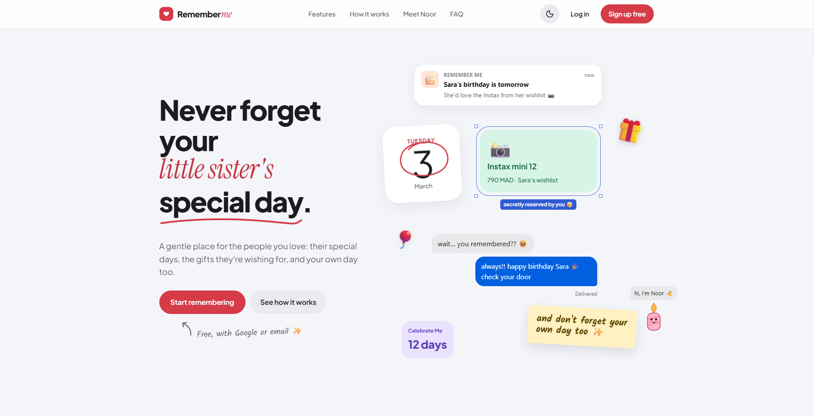
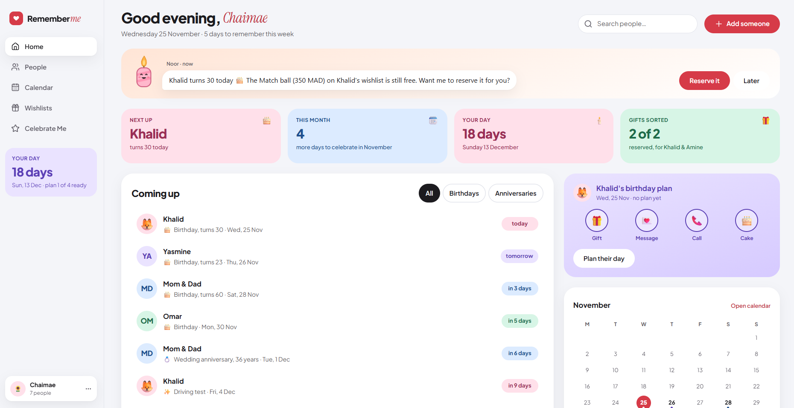

# Remember Me

Remember Me is a gentle web app for keeping track of the birthdays and special days of people you love, sharing wishlists, and remembering your own day too. Noor, a little birthday candle, offers optional help while your plans and personal details stay under your control.

**Live demo:** [rememberme.shemme.codes](https://rememberme.shemme.codes)




## What it does

- Keep birthdays and other important days in one place, with reminders.
- Create plans and wishlists, and connect with friends.
- Reserve gifts privately. Wishlist owners never see reservations or who made them.
- Install the app as a PWA and use its offline shell.
- Optionally ask Noor questions about Remember Me, with answers grounded in its help content.
- Check the generic `GET /api/health` endpoint to see whether the app can reach its database; it returns no connection details.

## Technology

Next.js App Router, React, TypeScript, Tailwind CSS, Radix UI, Supabase (Postgres, Auth, Storage, Edge Functions), Vitest, Playwright, pgTAP, and GitHub Actions.

The web app uses server components by default. Supabase Row Level Security protects user data. Edge Functions handle tasks that need server-side secrets, such as reminders and optional AI requests. The PWA caches static app resources, not private account data.

## Run it locally

### Requirements

- Node.js 22 or newer
- pnpm 11.14.0 (the version pinned in `package.json`; Corepack can provide it)
- Docker Desktop, running

### 1. Install dependencies and start local Supabase

```sh
pnpm install
pnpm db:start
```

Supabase starts a local database, Auth, Storage, and Mailpit. The first start may take a few minutes while Docker downloads the local images.

### 2. Configure the app

Copy `.env.example` to `.env.local`, then fill in the local Supabase URL and publishable key printed by:

```sh
pnpm exec supabase status
```

Use the local API URL (usually `http://127.0.0.1:54321`) and its publishable key. These are local development values. Never put a secret key in a `NEXT_PUBLIC_*` variable.

PowerShell:

```powershell
Copy-Item .env.example .env.local
```

macOS or Linux:

```sh
cp .env.example .env.local
```

### 3. Add demo data and run the app

```sh
pnpm seed:demo
pnpm dev
```

Open [http://localhost:3000](http://localhost:3000). Demo accounts are created only in the local Supabase instance:

| Account | Email                            |
| ------- | -------------------------------- |
| Maya    | `demo.maya@remember-me.test`   |
| Khalid  | `demo.khalid@remember-me.test` |
| Sara    | `demo.sara@remember-me.test`   |
| Amine   | `demo.amine@remember-me.test`  |

The local demo password is `local-only-demo-password-0000`. Do not reuse it outside the local demo. The seed command refuses non-local Supabase URLs.

Supabase Studio is at [http://127.0.0.1:54323](http://127.0.0.1:54323), and Mailpit is at [http://127.0.0.1:54324](http://127.0.0.1:54324). Local email is captured in Mailpit and is not delivered.

To stop the local database, run `pnpm db:stop`. To reset it and apply migrations again, run `pnpm db:reset`.

### Optional local Edge Functions

Copy [`supabase/functions/local-dev.env.example`](supabase/functions/local-dev.env.example) to `supabase/functions/local-dev.env`, then run `pnpm functions:serve`. The copied file is ignored by Git and contains local-only values. Never use production secrets here.

PowerShell:

```powershell
Copy-Item supabase/functions/local-dev.env.example supabase/functions/local-dev.env
```

macOS or Linux:

```sh
cp supabase/functions/local-dev.env.example supabase/functions/local-dev.env
```

Push delivery is optional. To test it locally, generate a dedicated VAPID key pair and put it in the ignored local file and `.env.local`. Never reuse a production pair.

## Optional Noor help

Noor's optional help assistant uses **Retrieval-Augmented Generation (RAG)**. It retrieves passages from the help content, FAQ, and public legal pages, then grounds its answer in those passages. The response is validated and links back to its sources. If no relevant passage is found, Noor does not make a generation request.

Ask Noor is off by default. To enable it locally, configure a supported provider for the local Supabase Edge Functions and set the relevant feature flags. Keep provider credentials server-side. `AI_MOCK=1` enables scripted responses in tests without calling a provider.

## Checks

```sh
pnpm lint
pnpm format:check
pnpm typecheck
pnpm test
pnpm db:test
pnpm e2e
```

Database and browser tests need Docker and the local Supabase stack. `pnpm build` creates a production build; `pnpm lighthouse` runs the configured Lighthouse checks after a build.

## Project layout

```text
src/app/                 App Router pages and route handlers
src/components/          Shared UI components
src/features/            Feature components, actions, schemas, and queries
src/lib/                 Shared utilities, Supabase clients, and validation
src/ai/                  Optional AI prompts, schemas, and helpers
supabase/migrations/     SQL schema changes
supabase/functions/      Edge Functions
supabase/tests/          Database and RLS tests
e2e/                     Playwright end-to-end tests
docs/                    Product, design, data, and contributor documentation
```

## Roadmap

The web app is the supported application today. Share feature ideas through the repository's issue tracker.

## Contributing

Issues and pull requests are welcome. Read [`CONTRIBUTING.md`](CONTRIBUTING.md) before opening a change. Please include tests for behavior changes and never include real credentials, personal data, or production database content.

## License and contact

Licensed under the [MIT License](LICENSE). For security issues, follow [`SECURITY.md`](SECURITY.md).

- Project: [github.com/s-shemmee/remember-me](https://github.com/s-shemmee/remember-me)
- Maintainer: [@s-shemmee](https://github.com/s-shemmee)
- Contact: [contact@shemme.codes](mailto:contact@shemme.codes)
