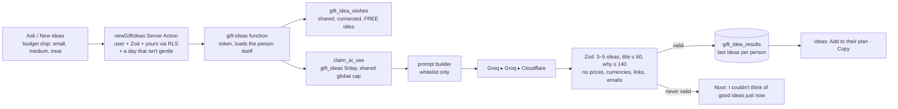

# AI (Noor)

Goal: practise real AI product engineering (tool calling, structured output, RAG, embeddings, background agents, evals, guardrails) on features people actually want. The app must work fully with AI switched off (`AI_ENABLED=false`).

## Architecture

Built in feat/ask-noor-rag (the groundwork every AI feature reuses):

- **Providers (`supabase/functions/_shared/ai.ts`):** Groq first, Cloudflare Workers AI as fallback. Both speak the OpenAI chat format, so plain `fetch` from Edge Functions, no SDK. JSON mode, temperature 0.2, a 15 s timeout each. Models come from env (`GROQ_MODEL`, default `llama-3.3-70b-versatile`; `CLOUDFLARE_MODEL`, default `@cf/meta/llama-3.3-70b-instruct-fp8-fast`). Keys are Supabase function secrets only, never in the Next app or Vercel. (This replaced the planned an earlier AI SDK integration: free tiers, and the calls belong next to the data.)
- **Embeddings:** Supabase's built-in **gte-small** (384 dims, mean-pooled and normalised), run inside Edge Functions for free. **gte-small is English-first:** questions in French, Darija or Arabic match less well and may be refused with "I can only help with Remember Me". That's acceptable for now; a multilingual model is the fix if people need it.
- **Schemas:** Zod for every input and output: `src/ai/ask-noor/answer.ts` (the question; the model's JSON) and `src/features/ask-noor/schema.ts` (the function's response, checked again in Next).
- **Limits:** `ai_usage_daily` (counts only: user, day, feature) and `claim_ai_use()` (service role): a per-user daily limit per feature (Ask Noor `AI_USER_DAILY_LIMIT`, default 20; gift ideas `AI_GIFT_IDEAS_DAILY_LIMIT`, default 5) and **one global daily cap shared by every AI feature** (`AI_GLOBAL_DAILY_CAP`, default 500). Old rows go after 30 days.
- **Switches:** `AI_ENABLED=true` turns on Ask Noor; `AI_GIFT_IDEAS_ENABLED=true` turns on gift ideas, on its own (server env; both off by default, and the app works fully without them). `AI_MOCK=1` gives scripted answers for e2e, and is ignored on Vercel.
- **Retry and fallback:** `generate(messages, { only })` can ask one provider, so a feature can order its own attempts. Gift ideas: Groq, Groq again, then Cloudflare.
- **Later:** prompts as versioned files, Langfuse traces, tools that only propose writes (Phase 1 quick add).

## Ask Noor (phase 1b, built)

A help assistant that answers **only from our own documents** (classic RAG): the help articles (`docs/help/*.md`, also the public `/help` pages), the landing FAQ, `/privacy` and `/terms`.

```mermaid
flowchart LR
  subgraph Index["pnpm ai:index (owner, after help changes)"]
    D[docs/help/*.md<br/>FAQ JSON-LD<br/>/privacy, /terms] --> C[chunk by heading<br/>~300–500 tokens, small overlap<br/>content hash]
    C --> F1[index-help function]
    F1 -->|only changed hashes| E1[gte-small embed]
    E1 --> T[(help_chunks<br/>vector 384, HNSW)]
  end
  subgraph Ask["A question in Settings"]
    Q[question ≤ 300 chars] --> SA[askNoor Server Action<br/>user + Zod]
    SA --> F2[ask-noor function<br/>token + daily limits]
    F2 --> E2[gte-small embed]
    E2 --> R[match_help_chunks<br/>top 5 ≥ threshold]
    R -->|nothing| X["Noor: I can only help<br/>with Remember Me 🕯️<br/>(no AI call)"]
    R -->|chunks| G[Groq, then Cloudflare<br/>documents trusted,<br/>question untrusted]
    G --> V[Zod: answer, sources[]<br/>sources ⊂ retrieved]
    V -->|invalid twice| U[Noor: I'm not sure]
    V -->|valid| A[answer + links to /help]
  end
```

- **Retrieval:** the question is embedded with the same model, and `match_help_chunks()` returns the top 5 above `ASK_NOOR_THRESHOLD` (default 0.80, tuned with the evals). **Nothing above it: no AI call at all.**
- **Generation:** Noor's system prompt says to answer only from the documents, in her voice (first person, short, warm, at most one emoji, no em dashes), and to return `{ answer, sources[] }` with the keys of the documents used, or an empty answer when they don't cover it.
- **Validation:** Zod checks the shape; **every source must be one of the retrieved chunks**, or the answer is rejected (one retry, then "I'm not sure"). Em dashes are turned into commas.
- **Prompt injection:** the documents are trusted; the question is wrapped in `<question>` as untrusted data that may not change the rules or the format, and it can't close its delimiter or add a document. Even an obeyed injection can only cite retrieved chunks.
- **Privacy:** questions are never stored or logged (not in Sentry either); only the daily count per user. Groq or Cloudflare see the question and the matching help text, never names, emails or people.
- **Evals:** `docs/ai/evals/ask-noor.json` (15 questions with their expected page, plus 3 that must be refused). `pnpm ai:eval` runs them against the real providers and prints the pass rate (it exits 1 under 80%). **Never in CI.**
- **Tests:** Vitest (the chunker, sources, threshold refusal, source validation, prompt injection, the Server Action), pgTAP (`supabase/tests/ask_noor.test.sql`: read-only chunks, server-only writes and counts, the caps), Playwright (`e2e/ask-noor.spec.ts` with `AI_MOCK=1`).

## Gift ideas (phase 1, built)

"Ask Noor for gift ideas 💡" on a person's panel, and in Home's nudge when the next day is a birthday. Never for a Remembrance day or someone "In memory" (hidden in the UI, refused by the Server Action and the function). It's for their next day that isn't gentle.



- **Whitelist (`src/ai/gift-ideas/prompt.ts`, pure and unit-tested):** the first word of their name, the relation chip (never the free-text relation), the occasion type, the budget word, up to 20 little things, and up to 10 titles of wishes on their shared "My birthday" list **that nobody has reserved** (so Noor never suggests a gift someone else is already giving). Never emails, birth dates or years, notes, prices, links, reservations or anyone else's data. The builder copies those fields one by one, so extra fields on a row can't slip through.
- **Untrusted data:** little things and wish titles go in a `<data>` block the model is told never to obey; they can't open or close the delimiters.
- **Output:** JSON `{ ideas: [{ title, why }] }`, checked by Zod (`src/ai/gift-ideas/ideas.ts`) and again in Next. Invalid: Groq once more, then Cloudflare, then Noor's friendly message (never a made-up list).
- **Saved:** `gift_idea_results` keeps the last ideas per person, so reopening costs nothing. "New ideas" uses one of the day's 5.
- **Add to their plan:** opens the plan for that day, then **renames its unticked Gift step to the idea**, or adds a new unticked Gift step when there's none or it's already ticked. Never ticked: it's an idea to act on.
- **Privacy:** prompts and ideas are never logged or sent to Sentry. Groq or Cloudflare see only the whitelist above.
- **Evals:** `docs/ai/evals/gift-ideas.json` (8 fictional people, one with a prompt injection in a little thing). `pnpm ai:eval gift-ideas` checks 3–5 ideas, the length limits, no prices or links, and that an idea mentions one of their little things. **Never in CI.**
- **Tests:** Vitest (forbidden fields never sent, free wishes only, delimiters, gentle days, the schema, retry and fallback, the limit messages, the rename-or-add rule), pgTAP (`supabase/tests/gift_ideas.test.sql`: owner-only results, server-only writes, deleted with the person, free and connected wish titles only, the shared cap), Playwright (`e2e/gift-ideas.spec.ts` with `AI_MOCK=1`).

## Phases

**Phase 1b (built): Ask Noor**, the help assistant above. **Phase 1 gift ideas (built)**, above.

**Phase 0 (v1 launch): no AI.** Noor's messages come from templates in `src/features/noor/messages.ts`. Ship the core app first.

**Phase 1: Quick add + link preview**
- *Talk to Noor:* "Add Sara, best friend, birthday 3 March, loves Instax" → `PersonDraft` (name, relation, occasions[], little_things[]). Show a confirm card, then save.
- *Paste a product link:* Edge Function fetches the page (SSRF-safe), the LLM extracts `{title, price, currency, image}` from the page text. Fallback to Open Graph tags; for sites that block simple fetching, Firecrawl later.
- Skills practised: structured output, tool calling, input/output validation, untrusted web content.

**Phase 2: Gift ideas + wish writer (RAG)**
- *Gift ideas:* built in phase 1 (above). Later: past gifts as context.
- *Wish writer:* a birthday message in your tone; English, French or Darija; length short/medium; never more than 3 emoji.
- Cache results in Postgres for 24h per person to save cost.

**Phase 3: Embeddings (pgvector)**
- Embed people's little things, wishes and memories. Features: semantic search ("who loves photography?"), "similar gifts", duplicate detection on import.
- *Voice add:* "Noor, add Sara, birthday 3 March" by voice. Start with the browser's Web Speech API; move to Whisper (via API) if accuracy needs it.
- *Smart import:* paste a WhatsApp birthday list or upload a screenshot → vision model extracts people and dates → review table → save.

**Phase 4: Proactive Noor (agent)**
- Daily job per user: Noor reads the next 30 days (read-only tools), decides the single most useful nudge, writes it in her voice. Hard limits: max 1 nudge/day, no write tools, budget per run, full trace.

## Guardrails
- Minimise data: send first names, relations, little things. Never emails, phone numbers, birth years, other users' private data.
- Prompt injection: text from web pages, imports and notes is **data**. Wrap it in delimiters, tell the model it is untrusted, and never let it trigger tools.
- Validate every output with Zod; on failure, retry once, then fall back to a template.
- Show the user what Noor will save before saving. Everything AI-made is editable.
- Content safety: refuse hateful or sexual requests politely; keep gift ideas legal and age-appropriate.

## Evals (`evals/`)
- One folder per feature: `cases.jsonl` (input + expected fields or rubric) and a runner (Vitest).
- Types: exact checks (dates and names extracted correctly), schema validity rate, rubric scoring by an LLM judge (tone, helpfulness, no invented prices), safety cases (injection attempts must not change behaviour).
- Run in CI when `src/ai/**`, `evals/**` or prompts change. Fail the PR if the score drops below the stored baseline.
